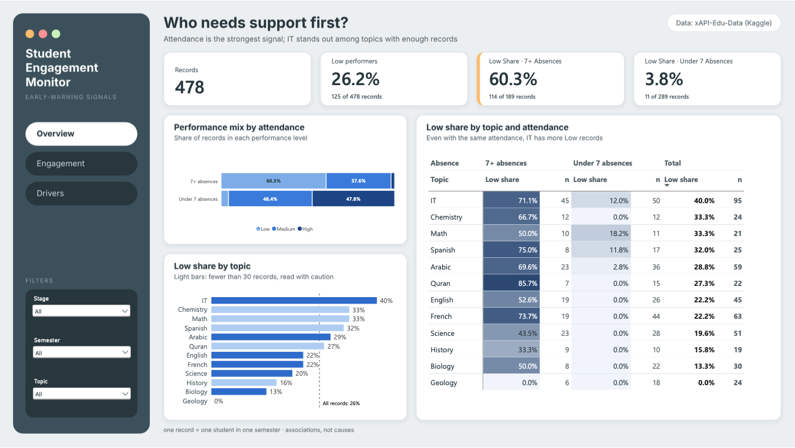
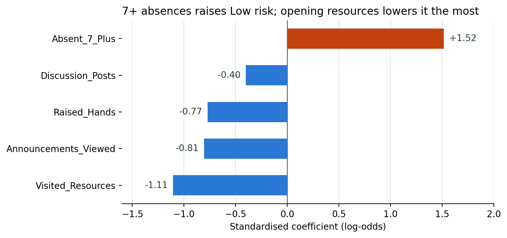
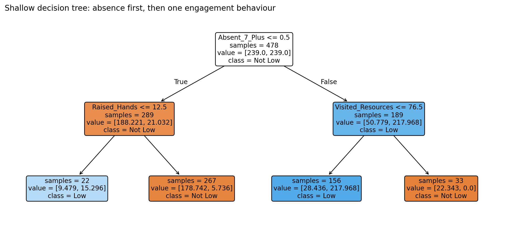

# Student Engagement Monitor

**Can attendance and learning-platform engagement flag students who need support early?**

A portfolio project that cleans a public education dataset in Python, explores it, builds a simple early-warning model, and presents the results in a three-page Power BI dashboard for a student support team.



---

## Business question

A student support team has limited time. It needs to know **who to contact first** and **which behaviours to encourage**.

1. Which engagement behaviours are linked to Low performance?
2. How different is the Low share for students with 7+ absences?
3. Which topics have a higher Low share?
4. Can engagement and attendance alone flag records that end up in the Low group?

## Data

- **Source:** Students' Academic Performance Dataset (xAPI-Edu-Data), Kaggle, collected from the Kalboard 360 learning platform.
- **Size:** 480 records, 17 columns; 478 after removing 2 exact duplicates.
- **Performance groups:** Low (0–69), Medium (70–89), High (90–100), as described by the dataset authors.
- **One record = one student in one semester.** There is no student ID, so records are counted, not students.

## Tools

| Step                    | Tool                                                                               |
| ----------------------- | ---------------------------------------------------------------------------------- |
| Cleaning and validation | Python (pandas), `assert` checks                                                   |
| Analysis and charts     | Python (pandas, seaborn, matplotlib)                                               |
| Model                   | Python (scikit-learn): logistic regression, decision tree, 5-fold cross-validation |
| Dashboard               | Power BI (Power Query, DAX, data model with an unpivoted engagement table)         |

## Project structure

```
student-engagement/
├── data/
│   ├── raw/              # original CSV (not committed)
│   └── clean/            # cleaned CSV from 01_clean
├── notebooks/
│   ├── 01_clean.ipynb    # cleaning + automatic checks
│   ├── 02_analysis.ipynb # answers to questions 1–3
│   └── 03_model.ipynb    # early-warning model (question 4)
└── reports/              # chart images and the dashboard PDF
```

The Power BI file (.pbix) is kept private. All three dashboard pages are in [`reports/Student_Engagement_Monitor.pdf`](reports/Student_Engagement_Monitor.pdf).

## Data cleaning (01_clean)

- Removed **2 exact duplicate rows** (rows 326 and 327 copy rows 322 and 323): 480 → 478.
- Fixed column name typos (e.g. `VisITedResources` → `Visited_Resources`).
- Standardised country names (`KW` / `KuwaIT` → Kuwait, `lebanon` → Lebanon, `Tunis` → Tunisia).
- Made codes readable (`lowerlevel` → Elementary, `F` / `S` → First / Second).
- Added helper columns: `Record_ID`, `Performance`, `Is_Low_Performer`, `Absent_7_Plus`, `Engagement_Score`.
- **Automatic checks** before saving: row count, no missing values, no duplicates, values within 0–100, no old typos.
- Kept and noted 1 record listing Grade 7 under Elementary (the other 100 Grade 7 records are Middle School).

## Key findings

| Finding                          | Result                                                                                                 |
| -------------------------------- | ------------------------------------------------------------------------------------------------------ |
| Overall Low share                | **26.2%** (125 of 478 records)                                                                         |
| Attendance                       | **60.3%** Low with 7+ absences vs **3.8%** with fewer                                                  |
| Engagement (Low vs High average) | Resources **18 vs 79**, hands raised **17 vs 70**, announcements **16 vs 53**, discussion **31 vs 54** |
| Topics (30+ records)             | **IT 40.0%** is highest; it stays higher even within the same absence group                            |

Discussion shows the smallest gap between Low and High, so not every type of engagement is an equally strong signal.

## Early-warning model (03_model)

Features: 4 engagement counts + 7+ absences. **Gender, nationality and parent satisfaction were left out on purpose.**

| Approach                   | Recall (Low found) | Precision | Missed Low | False flags |
| -------------------------- | ------------------ | --------- | ---------- | ----------- |
| Baseline: 7+ absences only | 91.2%              | 60.3%     | 11         | 75          |
| **Logistic regression**    | **94.4%**          | **75.2%** | **7**      | **39**      |
| Decision tree (depth 2)    | 85.6%              | 66.9%     | 18         | 53          |

- Adding engagement found more Low records and cut false flags almost in half (75 → 39).
- Strongest signals: **7+ absences** raises the risk (+1.52); **visited resources** lowers it the most (−1.11).
- The decision tree gives a simple rule: with 7+ absences, records that opened resources fewer than ~77 times were flagged.





## Power BI dashboard

| Page           | Question                             | Visuals                                                                                 |
| -------------- | ------------------------------------ | --------------------------------------------------------------------------------------- |
| **Overview**   | Who needs support first?             | KPI cards, performance mix by attendance, Low share by topic, topic × attendance matrix |
| **Engagement** | Which behaviours are early signals?  | Low vs High KPI cards, grouped bar, scatter plot, record-count map                      |
| **Drivers**    | Where is the Low share concentrated? | Decomposition tree (absence → topic → stage)                                            |

Every dashboard number was checked against the Python results.

📄 **[View the full dashboard (PDF, 3 pages)](reports/Student_Engagement_Monitor.pdf)**

## Limitations

- **Associations, not causes.** The results do not show that more engagement would raise results.
- **Same student, two semesters.** With no student ID, one student's records can fall in both training and test folds, so model scores may be slightly optimistic.
- **Small, specific sample.** 478 K–12 records, mostly from Kuwait and Jordan. Results and thresholds may not apply to other students or to Canadian postsecondary settings.
- **Small groups.** Groups with fewer than 30 records are flagged in the dashboard and should be read with caution.
- **Use as a support signal.** A flag means "check in with this student", not a judgement about them.

## Data citation

Dataset: [xAPI-Edu-Data on Kaggle](https://www.kaggle.com/datasets/aljarah/xAPI-Edu-Data)

- Amrieh, E. A., Hamtini, T., & Aljarah, I. (2016). Mining Educational Data to Predict Student's Academic Performance using Ensemble Methods. _International Journal of Database Theory and Application_, 9(8), 119–136.
- Amrieh, E. A., Hamtini, T., & Aljarah, I. (2015). Preprocessing and analyzing educational data set using X-API for improving student's performance.

## License

**Data:** The original dataset (xAPI-Edu-Data) by Elaf Abu Amrieh, Thair Hamtini and Ibrahim Aljarah is licensed under [CC BY-SA 4.0](https://creativecommons.org/licenses/by-sa/4.0/) and was downloaded from [Kaggle](https://www.kaggle.com/datasets/aljarah/xAPI-Edu-Data).
Changes made: removed 2 exact duplicate rows, fixed spelling of country names, renamed columns, and added helper columns (e.g., `Engagement_Score`, `Is_Low_Performer`).
The cleaned file `data/clean/student_engagement_clean.csv` is shared under the same CC BY-SA 4.0 license.

**Code:** The notebooks in this repository are my own work.
